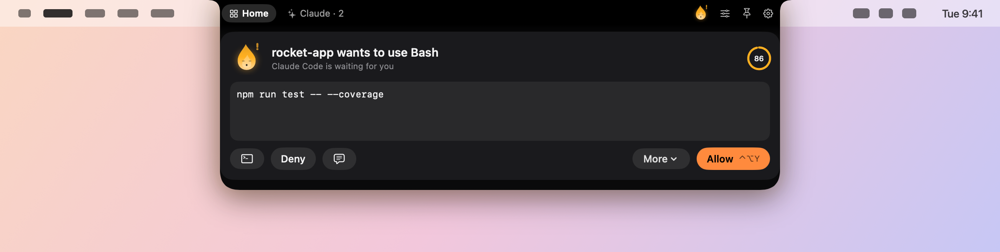
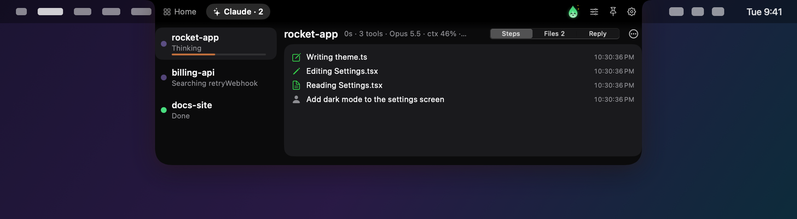
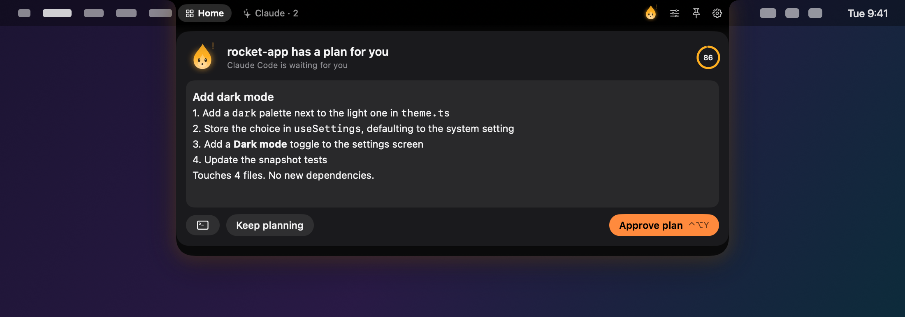
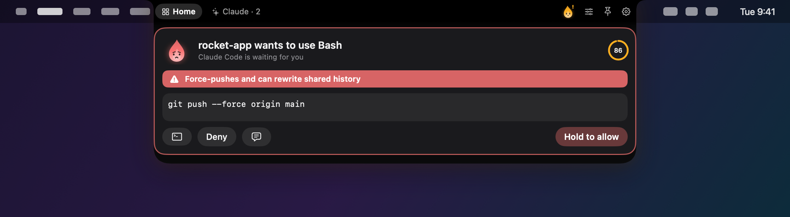
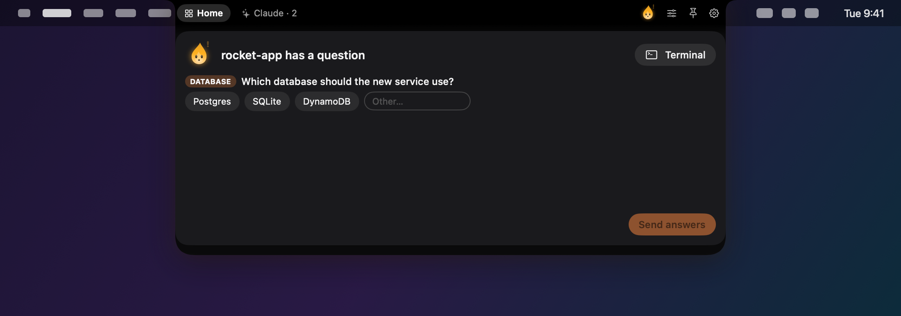
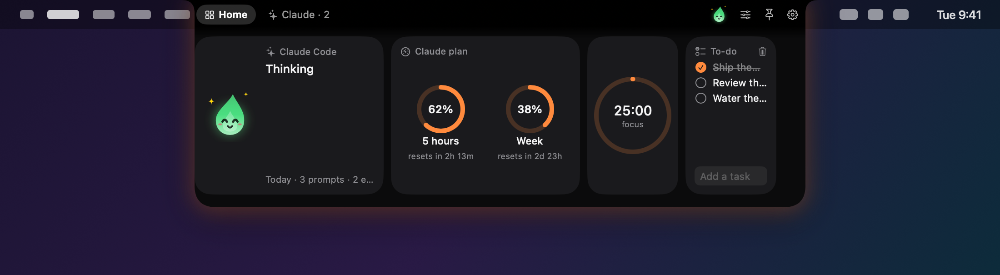
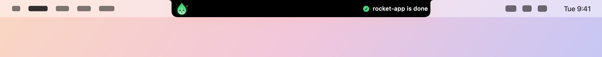

<div align="center">


# Wisp

**A little spirit that lives in your Mac's notch and keeps an eye on Claude Code.**

[](https://github.com/app-dialect/Wisp/releases)
[](https://github.com/app-dialect/Wisp/releases)
[](https://github.com/app-dialect/Wisp/stargazers)
[](https://github.com/app-dialect/Wisp/actions/workflows/ci.yml)


[](LICENSE)


[**⬇️ Download the beta**](https://github.com/app-dialect/Wisp/releases) · [Features](#-features) · [Install](#-install) · [Make it yours](#-make-it-yours) · [Privacy](#-privacy) · [Contribute](#-contributing)

<br>

<picture>
  <source media="(prefers-color-scheme: dark)" srcset="docs/images/hero-dark.png">
  
</picture>

</div>

<br>

Claude Code is great until it stops to ask *"can I run this?"* while you're in another window. **Wisp lives in your notch and tells you.** It shows what every session is doing, step by step, and lets you answer permissions and Claude's questions from wherever you are, without switching to the terminal.

And it's a little character: a wisp that thinks when Claude thinks, bounces when it needs you, celebrates when it's done, falls asleep when it's quiet, and wears a witch hat in late October.

> [!NOTE]
> **Wisp is in public beta.** It's a daily driver, but expect rough edges. [Report anything odd](https://github.com/app-dialect/Wisp/issues/new/choose).

## ✨ Why Wisp

|  |  |
|---|---|
| ✳️ **Claude Code, live** | Every session in the notch: what it reads, edits and runs, the files it changed with diffs, its last reply, and the tokens it used. |
| ✅ **Answer from anywhere** | Allow, Deny, Always, *this session only*, or *deny and tell Claude what to do instead*. Review plans as rendered Markdown. Claude's questions show up as chips you click. Global shortcuts too. |
| 🛡 **A second look at risky commands** | `rm -rf`, force-pushes, `DROP TABLE`, `sudo`, `curl … \| sh` get a red banner, are never auto-allowed, and need a press-and-hold. |
| 📊 **Plan usage, in the notch** | Your 5-hour and weekly limits, each session's model, context and cost, with a heads-up before you hit a wall. |
| 🤝 **Claude Code and Codex** | Both speak the same hooks; connect either or both. |
| 🔥 **A real character** | Six shapes, nine moods, ten outfits, three personalities. Its eyes follow your pointer. Poke it. Poke it five times. |
| 🎨 **Customize everything** | 10 themes plus any accent, 4 typefaces, notch or floating island, size, corners, motion, glow, glass, what sits beside the camera, every sound, every shortcut. Share your look as a code. |
| 🧩 **18 tiles** | Music, next meeting with Join, weather, focus timer, clipboard, file shelf, to-do, world clock, system, day progress, switches, a weekly recap and more. |
| 🫥 **Out of the way** | Black on black inside the notch until something happens. Hover to open, move away to close. |
| 🔒 **Private** | No account, no analytics. Two optional network calls, both [listed below](#-privacy). |
| 🛠 **Hackable** | Plain SwiftPM, no Xcode project. Open it in Claude Code and type `/make-it-mine`. |

## 👀 A look around

| | |
|---|---|
|  **Every session, live.** Steps, files changed, Claude's last reply. |  **Review plans** as formatted Markdown before Claude starts. |
|  **Risky commands** get a warning and a press-and-hold. |  **Claude's questions** as chips you click. |
|  **Tiles** for plan usage, music, meetings, timers and more. |  **Peeks** slide out of the notch when something happens. |

## 🧩 Features

### In the notch
- **Claude sessions** with a live step timeline, files changed with `+/−` counts and inline diffs, Claude's last reply (rendered Markdown), model, context bar, cost, and tokens per session.
- **Jump to the exact tab**: Terminal and iTerm2 sessions are matched by tty, so Wisp selects the right window and tab; other terminals (VS Code, Warp, Ghostty, WezTerm, Zed) come to the front.
- **Reply from the notch**: when a Terminal or iTerm2 session finishes, type your next message in the notch and Wisp sends it to that tab.
- **Permission card**: the full command, a countdown, and Allow / Deny / *Deny with a note* / *Answer in terminal*, plus *Allow for this session*, *Always*, and *Trust this session* (revocable, kept in memory). When several are waiting, *Allow all* approves the ones that aren't risky. If you don't answer in time, Claude Code simply asks in the terminal.
- **Plan review**: when Claude wants to leave plan mode, read the plan as formatted Markdown, then *Approve plan* or *Keep planning* with feedback.
- **Risk guard**: risky commands and sensitive files (`.env`, `~/.ssh`, credentials) get a warning banner, can't be approved with a shortcut or a blanket rule, and need a one-second press-and-hold.
- **Plan usage**: Claude Code hands its status line your 5-hour and weekly limits (Pro and Max plans). Wisp reads them there, shows them in a tile or a wing, and warns at 80% and 95%. It also warns when a session's context is nearly full. Any status line you already had keeps working: Wisp wraps it.
- **Questions card**: Claude's `AskUserQuestion` prompts as clickable choices, single or multi-select, with an *Other…* field.
- **Wings**: pick what sits left and right of the camera: your wisp, Claude status, plan usage, music with an equalizer tinted from the album art, synced lyrics, focus timer, clock, battery, CPU sparkline or a meeting heads-up. Show them always, never, or only when something's live.
- **Peeks**: "rocket-app is done", "83% of your 5-hour limit", "Charging · 64%", "Downloaded report.pdf", sliding out from the wings.
- **Steps aside for full-screen** videos, games and slides, unless an agent needs you.
- **Drop files on the notch** to put them on the shelf. Drag them back out, AirDrop them, reveal them.

### Tiles
Claude Code · Plan Usage · Now Playing with synced lyrics (Spotify, Apple Music) · Next Meeting with Join (Zoom, Meet, Teams, Webex…) · Weather · Focus Timer · Clipboard · Shelf · To-do · World Clock · System · Day Progress · Switches (keep awake, dark mode, mic mute, snooze, sound) · Dev Servers (what's listening on localhost: open or stop it) · Apple Shortcuts · Mirror (camera check before a call) · Wisp Says · Week with Claude

Tiles come in three widths. Rearrange them in Settings, or right in the island: click the sliders button and they start to wiggle.

### Your wisp
- **Shapes**: flame, orb, ghost, pixel, cat, star.
- **Moods**: idle, thinking, needs you, happy, oops, sleeping, vibing to music, poked, dizzy.
- **Wardrobe**: party hat, beanie, crown, witch hat, Santa hat, headphones, sunglasses, bow, or *dress for the season*, which picks for you (headphones whenever music plays).
- **Personality**: calm, lively or sleepy changes how it moves and how soon it naps.
- **Color**: follow its mood, the theme accent, a custom color, or rainbow.
- **Desktop buddy**: let it roam the desktop as a floating friend you can drag anywhere.

### Also
- **Weekly recap**: seven days of prompts, edits, commands, approvals and tokens, saved as a 1080×1350 image to share.
- **Snooze and quiet hours**, so the notch stays calm when you want it to.
- **Allow rules**: auto-allow read-only tools, or keep your own rules (`Bash` starting with `npm test`, in this project only).
- **Sounds** synthesized on your Mac in five packs (Chime, Glass, Wood, Retro 8-bit, Bubble), or drop in your own `done.wav`, `needs-you.mp3`…
- **Shortcuts** you can re-record. Permission shortcuts exist only while a request is on screen, so they never steal keys from other apps.
- **Any Mac**: no notch? Wisp draws one, or switch to a floating island under the menu bar. Pick the display, or let it follow your pointer.

## 📦 Install

**Download:** grab `Wisp-0.1.0.dmg` from [Releases](https://github.com/app-dialect/Wisp/releases) and drag Wisp to Applications. The beta isn't notarized yet, so the first time, right-click Wisp and choose **Open** (or allow it in System Settings → Privacy & Security).

**Build it yourself:** you need macOS 14 or later and the Xcode Command Line Tools.

```bash
xcode-select --install     # once, if you don't have them
./build.sh install         # builds and copies Wisp to /Applications
```

`./build.sh` alone builds `build/Wisp.app`; `./build.sh universal` builds for Apple silicon and Intel; `./build.sh dmg` also packages a disk image.

### Connect Claude Code

Settings (⌘,) → **Claude Code** → **Connect…**. Wisp shows the exact `hooks` section it will write to `~/.claude/settings.json`, saves a dated backup next to it, and writes only when you confirm. Disconnect removes only Wisp's entries.

The hook is [`Resources/wisp-hook.py`](Resources/wisp-hook.py): standard-library Python, run by the `/usr/bin/python3` that ships with macOS. **If Wisp isn't running, the hook exits in milliseconds and Claude Code works exactly as before.**

In the same place you can turn on **plan usage**, which routes Claude Code's status line through Wisp (your existing status line, if any, keeps working), and connect **Codex** if it's installed (`~/.codex/hooks.json`). Other agents that speak the same hook format can call the hook with `--agent NAME` to get their own label.

## 🎨 Make it yours

Most of it is in Settings. A few favorites:

- **Look** → pick a theme, your own accent, frosted glass, typeface, motion. *Copy look code* gives you a `wisp-look:` string friends can paste.
- **Island & Wings** → notch or floating, size, corners, what sits beside the camera.
- **Your Wisp** → name, shape, outfit, personality, color, desktop buddy. Try every mood with the preview buttons.
- **General** → export and import all your settings as JSON.

Want something Settings can't do? Open this folder in [Claude Code](https://claude.com/claude-code) and type `/make-it-mine`, or just say what you want: *"add a tile with my GitHub notifications"*, *"give the wisp a wizard hat"*. [`CLAUDE.md`](CLAUDE.md) is the map Claude follows, and [`CUSTOMIZE.md`](CUSTOMIZE.md) has prompts that work well.

## 🔒 Privacy

- No account, no analytics, no tracking.
- Wisp's data lives in `~/Library/Application Support/Wisp` (the socket, stats, the hook script, your custom sounds). Settings live in its preferences.
- Network calls, only if you use the feature:
  - **Weather**: [open-meteo.com](https://open-meteo.com), with your city's coordinates.
  - **Now Playing**: Spotify's cover art URL, for the artwork.
  - **Synced lyrics**: [lrclib.net](https://lrclib.net), with the song's title, artist, album and length.
- Plan usage is read from Claude Code's own status line on your Mac. Wisp never logs in to anything.
- Permissions, asked only when a feature needs them: **Calendars** (Next Meeting tile), **Automation** (Spotify/Music, Dark Mode switch, jumping to and typing into Terminal/iTerm2 tabs), **Camera** (Mirror tile), **Downloads folder** (download alerts).
- Clipboard history skips anything password managers mark as concealed.

## 🗺 Roadmap

- [ ] Precise jumping for Ghostty, WezTerm, Kitty and tmux panes
- [ ] More languages
- [ ] More outfits (community designs welcome)
- [ ] Notarized releases and a Homebrew cask

## 🤝 Contributing

Issues, ideas and pull requests are welcome. See [CONTRIBUTING.md](CONTRIBUTING.md); adding a tile takes about five minutes.

If Wisp makes your day a little nicer, a ⭐️ helps other people find it.

## 🙏 Inspiration

Wisp was inspired by notch apps for Claude Code, mainly [Pulsar](https://github.com/juliendesigncraft/pulsar) and [Coucou](https://github.com/louis-cfm/coucou), with ideas from Vibe Island (plan review, exact-tab jumping), Claude Pulse (the risk guard), FavTray (session-only trust), claude-peek (replying from the notch), and general notch apps like Boring Notch, NotchNook, Alcove, Notchy and Atoll (lyrics, mirror, Shortcuts, dev servers, heads-ups). Wisp's code, character and artwork are written from scratch.

## License

[MIT](LICENSE). Claude and Claude Code are trademarks of Anthropic. Spotify and Apple Music are trademarks of their owners. Wisp isn't affiliated with or endorsed by any of them.
